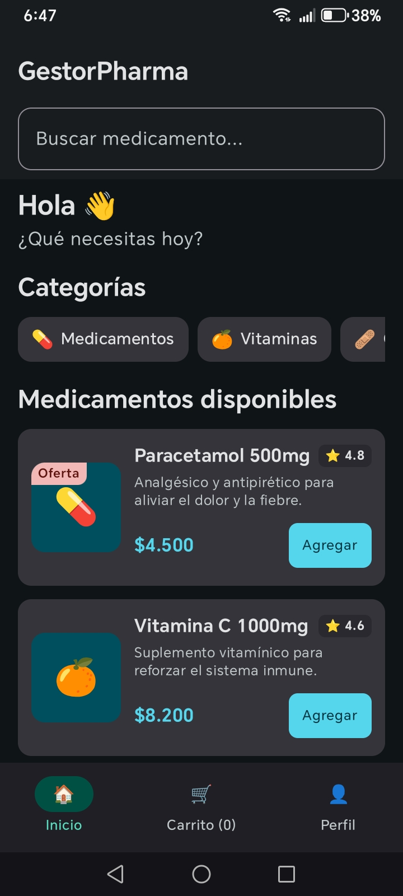
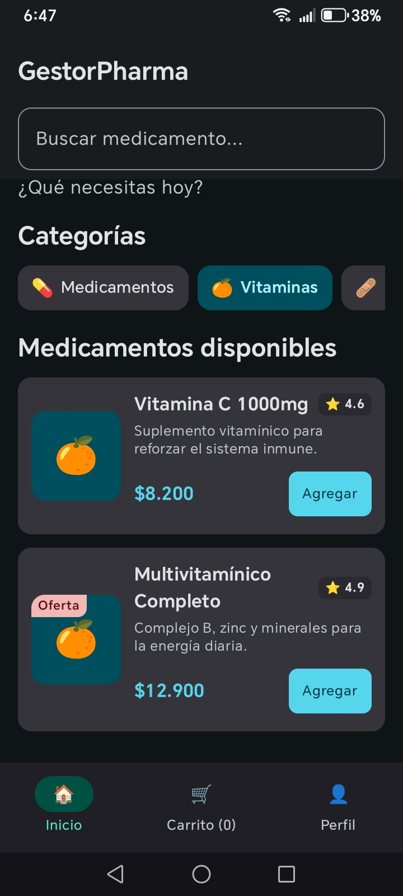
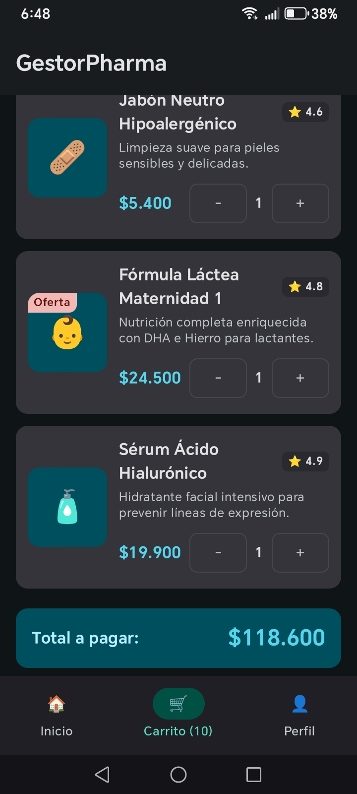

# GestorPharma - Sistema de Farmacia

Aplicación móvil Android para una farmacia, desarrollada con Kotlin y Jetpack Compose como proyecto de la asignatura Aplicativos Móviles.

Autor: Kevin ([@Kratos0996](https://github.com/Kratos0996))

---

## 1. El negocio

GestorPharma es una farmacia que ofrece medicamentos, vitaminas, productos de cuidado personal, artículos para bebé y maternidad, y dermocosmética.

## 2. Objetivo de la aplicación

Permitir que el cliente explore el catálogo de la farmacia, encuentre lo que necesita por búsqueda o por categoría, arme su pedido y vea en todo momento cuánto va a pagar.

---

## 3. Pantallas implementadas

La navegación se implementa con Navigation Compose (`NavController` y `NavHost`) y una barra inferior de tres destinos.

| Pantalla | Ruta | Descripción |
|---|---|---|
| Inicio | `inicio` | Saludo, buscador, categorías seleccionables (`LazyRow`) y lista de medicamentos (`LazyColumn`) con precio, calificación, etiqueta de oferta y controles para agregar al pedido. |
| Carrito | `carrito` | Muestra solo los productos agregados, permite cambiar sus cantidades y calcula el total a pagar. Si no hay productos, muestra un mensaje de carrito vacío. |
| Perfil | `perfil` | Pantalla del usuario. |

La barra inferior indica la pestaña activa y muestra la cantidad total de productos en el carrito.

---

## 4. Funcionalidades interactivas

### Funcionalidad 1: carrito con cantidades (trabajada en clase)

Cada producto muestra un botón "Agregar". Al pulsarlo aparecen los controles "-" y "+" con la cantidad seleccionada. Si la cantidad llega a 0, vuelve el botón "Agregar". Las cantidades se reflejan en la pantalla Carrito y en el contador de la barra inferior.

Cómo funciona: el estado es un `Map<Int, Int>` (id del producto a cantidad) guardado con `mutableStateOf` en `PharmacyApp` y compartido con las pantallas mediante elevación de estado (state hoisting), con los eventos `onIncrease` y `onDecrease`.

### Funcionalidad 2: filtro por categorías (nueva)

Las categorías (Medicamentos, Vitaminas, Cuidado Personal, Bebé y Maternidad, Dermocosmética) se muestran como tarjetas seleccionables. Al tocar una, la lista muestra solo los productos de esa categoría; al tocarla de nuevo, se quita el filtro. Funciona en conjunto con el buscador.

Cómo funciona: la categoría elegida se guarda como estado (`selectedCategory`) y la lista se calcula con `filter`, combinando el texto de búsqueda y la categoría.

### Funcionalidad 3: cálculo automático del total del pedido (nueva)

En el Carrito, el total a pagar se recalcula cada vez que se agrega, aumenta o disminuye un producto, y se muestra con formato de pesos colombianos.

Cómo funciona: se multiplica la cantidad de cada producto por su precio y se suma con `sumOf`, a partir del mismo estado del carrito, por lo que se actualiza automáticamente.

Nota: la búsqueda de productos por nombre o descripción también está disponible en Inicio, pero no se cuenta como una de las tres funcionalidades.

---

## 5. Componentes y organización del código

- Data classes: `Medicamento` y `Categoria`.
- Colecciones de datos: 10 medicamentos y 5 categorías definidos localmente.
- Listas dinámicas: `LazyColumn` y `LazyRow`, generadas a partir de las colecciones.
- Composables reutilizables: `ProductCard` (usado en Inicio y Carrito) y `CategoryCard`.
- Material 3: `Scaffold`, `TopAppBar`, `NavigationBar`, `Card`, `Button`, `OutlinedButton`, `OutlinedTextField` y `Surface`.
- Tema personalizado: `Color.kt`, `Theme.kt` y `Type.kt` en el paquete `ui.theme`.

```
app/src/main/java/com/example/sistemafarmacia/
├── MainActivity.kt        # Modelos, navegación, pantallas y componentes
└── ui/theme/
    ├── Color.kt
    ├── Theme.kt
    └── Type.kt
```

---

## 6. Capturas de pantalla

| Inicio | Filtro por categoría | Carrito con total |
|:---:|:---:|:---:|
|  |  |  |

---

## 7. Cómo ejecutar el proyecto

Requisitos: Android Studio (versión reciente) y un emulador o dispositivo Android.

1. Clonar el repositorio:
   ```bash
   git clone https://github.com/Kratos0996/SistemaFarmacia.git
   ```
2. Abrir la carpeta del proyecto en Android Studio (File > Open).
3. Esperar a que Gradle sincronice las dependencias.
4. Seleccionar un emulador o conectar un dispositivo con la depuración USB activada.
5. Ejecutar la aplicación con el botón Run.

---

## 8. Alcance de esta versión

Esta es la primera versión del proyecto. Los datos son locales y no incluye base de datos, conexión a API, autenticación, persistencia ni ViewModel; el estado se maneja con `remember` y `mutableStateOf`.

## 9. Tecnologías

Kotlin, Jetpack Compose, Material 3, Navigation Compose y Android Studio.