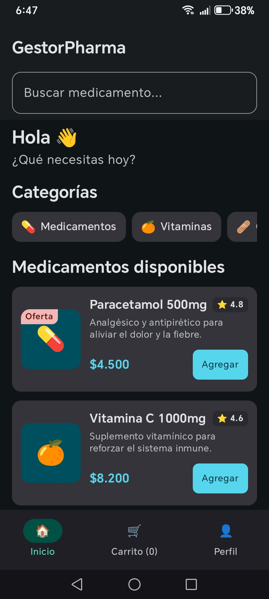
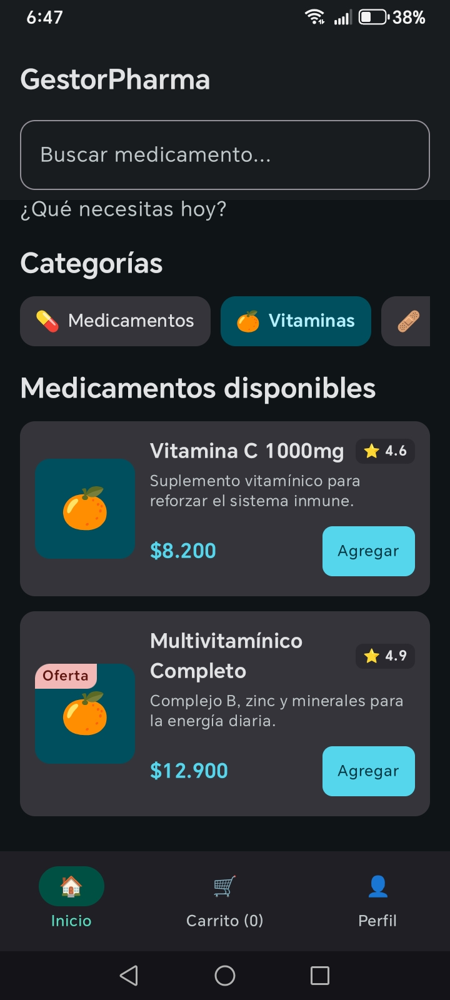
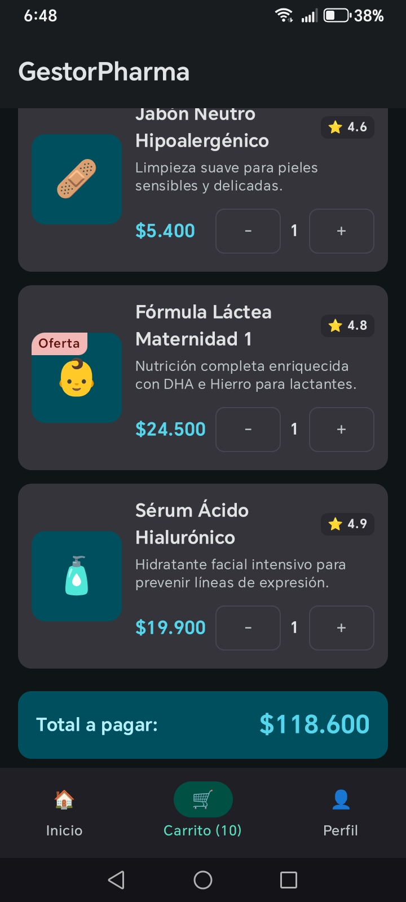

# GestorPharma - Sistema de Farmacia

Aplicación móvil Android para una farmacia, desarrollada con Kotlin y Jetpack Compose como proyecto de la asignatura Aplicativos Móviles.

Autor: Kevin Alarcón Muñoz ([@Kratos0996](https://github.com/Kratos0996))

---

## 1. El negocio

GestorPharma es una farmacia que ofrece medicamentos, vitaminas, productos de cuidado personal, artículos para bebé y maternidad, y dermocosmética.

## 2. Objetivo de la aplicación

Permitir que el cliente explore el catálogo de la farmacia, encuentre lo que necesita por búsqueda o por categoría, arme su pedido y vea en todo momento cuánto va a pagar, conservando los datos localmente en el dispositivo.

---

## 3. Pantallas implementadas

La navegación se implementa con Navigation Compose (`NavController` y `NavHost`) y una barra inferior de tres destinos.

| Pantalla | Ruta | Descripción |
|---|---|---|
| Inicio | `inicio` | Saludo, buscador en TopBar, categorías seleccionables (`LazyRow`) y lista de medicamentos (`LazyColumn`) con precio, calificación, etiqueta de oferta y controles para agregar al pedido. |
| Carrito | `carrito` | Muestra solo los productos agregados, permite cambiar sus cantidades y calcula el total a pagar. Si no hay productos, muestra un mensaje de carrito vacío. |
| Perfil | `perfil` | Pantalla del usuario. |

La barra inferior indica la pestaña activa y muestra la cantidad total de productos en el carrito.

---

## 4. Funcionalidades interactivas y Persistencia

### Funcionalidad 1: Carrito con cantidades y almacenamiento local en Room

Cada producto muestra un botón "Agregar". Al pulsarlo aparecen los controles "-" y "+" con la cantidad seleccionada. Las cantidades se guardan de forma persistente en una base de datos local **Room (SQLite)** en la tabla `cart_items`, manteniendo el estado del carrito incluso al reiniciar la aplicación.

### Funcionalidad 2: Filtro por categorías

Las categorías (Medicamentos, Vitaminas, Cuidado Personal, Bebé y Maternidad, Dermocosmética) se muestran como tarjetas seleccionables. Al tocar una, la lista muestra solo los productos de esa categoría; al tocarla de nuevo, se quita el filtro. Funciona en conjunto con el buscador de la barra superior (`TopBar`).

### Funcionalidad 3: Cálculo automático del total del pedido

En el Carrito, el total a pagar se recalcula automáticamente cada vez que se agrega, aumenta o disminuye un producto, y se muestra en una tarjeta resumen formateada en pesos colombianos.

### Persistencia de Datos Local (Room Database)

La aplicación utiliza la biblioteca de persistencia **Room Database** con procesador **KSP** para almacenar y consultar datos localmente:
- **`medicamentos`**: Almacena el catálogo con los 10 productos disponibles.
- **`cart_items`**: Guarda el estado y cantidad del carrito de compras.

---

## 5. Componentes y organización del código

El proyecto implementa la arquitectura recomendada por Google (UI -> ViewModel -> Repository -> Room DAO):

```
app/src/main/java/com/example/sistemafarmacia/
├── MainActivity.kt                  # Actividad principal, Compose UI y Navigation
├── data/
│   ├── local/
│   │   ├── CartItemEntity.kt        # Entidad Room para ítems del carrito
│   │   ├── MedicamentoEntity.kt     # Entidad Room para el catálogo de medicamentos
│   │   ├── FarmaciaDao.kt           # Data Access Object (DAO) con flujos reactivos
│   │   └── FarmaciaDatabase.kt      # Instancia Singleton de la base de datos Room
│   └── repository/
│       └── FarmaciaRepository.kt    # Repositorio (Single Source of Truth)
├── viewmodel/
│   └── FarmaciaViewModel.kt         # ViewModel y Factory con Kotlin StateFlow
└── ui/theme/
    ├── Color.kt
    ├── Theme.kt
    └── Type.kt
```

- **Data classes & Entities**: `Medicamento`, `Categoria`, `MedicamentoEntity`, `CartItemEntity`.
- **Patrón Repositorio & ViewModel**: Manejo del estado mediante `StateFlow` y flujos reactivos `Flow` / `combine`.
- **Material 3**: `Scaffold`, `TopAppBar`, `NavigationBar`, `Card`, `Button`, `OutlinedButton`, `OutlinedTextField` y `Surface`.

---

## 6. Capturas de pantalla

| Inicio | Filtro por categoría | Carrito con total |
|:---:|:---:|:---:|
|  |  |  |

---

## 7. Cómo ejecutar el proyecto

Requisitos: Android Studio (versión reciente) y un emulador o dispositivo Android.

1. Clonar el repositorio:
   ```bash
   git clone https://github.com/Kratos0996/SistemaFarmacia.git
   ```
2. Abrir la carpeta del proyecto en Android Studio (File > Open).
3. Esperar a que Gradle y KSP sincronicen las dependencias.
4. Seleccionar un emulador o conectar un dispositivo con la depuración USB activada.
5. Ejecutar la aplicación con el botón **Run**.

---

## 8. Alcance de esta versión

Esta versión incluye **persistencia local mediante Room Database (SQLite)**, **Patrón Repositorio** y **ViewModel con Kotlin StateFlow** para una arquitectura limpia y reactiva. Los datos del carrito y el catálogo de 10 productos se mantienen de forma persistente en el dispositivo.

## 9. Tecnologías

Kotlin, Jetpack Compose, Room Database (SQLite), KSP, Coroutines & StateFlow, Material 3, Navigation Compose y Android Studio.
